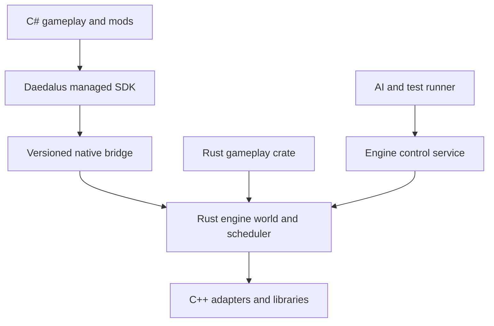

# 게임플레이·모드 SDK와 네이티브 확장

상태: 언어·반영 방식은 채택, API·ABI 세부는 설계 초안 · 2026-10-15

연결: REQ-017·020~025, [ADR-0003](../05-decisions/0003-csharp-and-native-gameplay.md), [핫리로드](scripting-and-hot-reload.md).

## 책임과 작성 경로

| 영역 | 기준선 | 코드 변경 반영 | 소유자 |
| --- | --- | --- | --- |
| 엔진 코어 | Rust, 필요한 C++ 부품은 명시적 FFI 어댑터 | 빌드·재시작 | 엔진 유지보수자 |
| 일반 게임플레이·PC 모드 | C# 14 / .NET 10 LTS / CoreCLR | 개발 reload·PC 모드 로드 계약 | 게임·모드 작성자 |
| Rust 게임플레이 | 엔진 버전에 맞춘 crate로 빌드 시 등록 | 재빌드·재시작 | 게임 개발자 |
| C++ 확장 | 물리·애니메이션 등 native 모듈의 통합 경로 | 플랫폼별 빌드·재시작 | 통합 담당자 |

Rust와 C++로 같은 엔진을 두 벌 구현하지 않는다. Rust가 코어 기준이며 C++ 부품을 연결할 수 있다. Rust 게임플레이는 엔진 포크 없이 시스템·컴포넌트·월드 생성기 등을 등록할 공개 경로를 제공한다. C++ 전체 게임플레이 SDK와 native DLL hot-reload까지 초기 지원으로 확대하지 않는다.

## 하나의 월드와 시스템 등록

Rust와 C#은 같은 entity ID/generation, component schema, 시간·난수 의미, 자산 handle, 서버 권한과 명령 결과를 사용한다. C#용 별도 권한 ECS를 만들지 않는다. 데이터를 두 언어에 복제했다면 권한 원본·읽기 시점·갱신 규칙을 표시한다.

시스템은 phase·read/write 집합·의존성·취소·예산을 등록한다. Rust 시스템은 scheduler가 허용한 실행 구간의 borrow/query로 데이터를 다룰 수 있고, C#은 초기에는 snapshot batch와 command batch를 사용한다. scheduler 밖에서 live world를 임의 수정하지 않는다. 동일 컴포넌트에 경쟁하는 writer가 있으면 순서를 선언하거나 등록을 거부한다.

게임이 코어 계산을 직접 작성하고 싶다면 Rust 경로를 선택할 수 있다. C#을 선택했다고 무거운 solver를 반드시 managed 코드로 옮기지 않으며, 성능 때문에 모든 규칙을 Rust로 옮기도록 강제하지도 않는다.

## C# wrapping 경계

managed SDK는 게임 개발자가 쓰는 타입·이벤트·행동·UI API를 제공한다. native bridge는 handle, 명시적 layout, 길이 있는 buffer, 오류와 버전을 다룬다. SDK의 메서드 하나마다 작은 FFI 호출을 만드는 방식 대신 내부에서 조회·명령을 배치한다. 이벤트 중심 API와 성능용 batch system API는 같은 의미 계약 위의 작성 표면이다.

새 컴포넌트는 안정적인 schema ID·version·field 형식·직렬화·migration을 등록한다. CLR 객체 참조를 Rust component 메모리에 그대로 넣지 않는다. Rust 전용 컴포넌트를 저장·네트워크·C#에 노출하려면 별도 schema 등록이 필요하다.

초기 경로는 소유권이 명확한 복사 batch다. zero-copy는 실측 이득이 있을 때 tick/job 수명이 제한된 lease로 별도 설계한다. raw pointer·span을 await·모듈 교체 뒤까지 유지하지 않는다. C#의 unmanaged 제약이나 Vector3라는 이름만으로 Rust와 ABI가 같다고 판단하지 않는다.

## ABI·C++·오류 경계

공개 native bridge는 타깃별 C ABI와 엔진이 정한 schema/version 계약을 사용한다. C ABI 자체가 모든 OS·CPU의 바이너리 호환을 제공하지는 않는다. Rust 기본 ABI는 안정성을 보장하지 않으므로 빌드 시 연결하는 Rust crate의 API와 다운로드 가능한 binary ABI를 구분한다. [Rust ABI](https://doc.rust-lang.org/reference/items/external-blocks.html#abi)

C++는 C wrapper 또는 검증한 bridge 후보를 통해 연결한다. CXX는 후보이지 채택·검증한 의존성이 아니다. allocator/free 주체, 문자열·배열 길이, 정렬, callback 수명, thread affinity와 오류 변환을 어댑터별로 기록한다. C++ 예외·Rust panic·managed 예외를 외부 언어 경계로 흘려보내지 않도록 설계하며 panic=abort·native crash는 오류 코드로 회복할 수 있다고 약속하지 않는다. [Rust FFI](https://doc.rust-lang.org/nomicon/ffi.html), [CXX](https://cxx.rs/)

## PC 플러그인 패키지와 신뢰

PC는 설치형 데스크톱을 뜻하며 현재 Mac에서도 같은 계약을 조사한다. 모드 manifest에는 ID·버전·엔진/SDK 범위·진입 assembly·의존성·content hash·자산·schema 목록과 필요한 native 타깃을 둔다. 로컬 폴더 로더를 배포 서비스와 분리한다. Steam Workshop 등은 배포 어댑터 후보이며 실행 런타임·SDK 호환성·hot-reload 기능을 대신하지 않는다. [Steam Workshop](https://partner.steamgames.com/doc/features/workshop)

모드별 AssemblyLoadContext와 dependency resolver를 검토하되 공통 SDK 계약 assembly는 공유해 type identity 충돌을 피한다. 누락·버전 충돌·순환 의존·틀린 CPU/OS binary는 world 변경 전에 진단한다. 외부 .NET·native 라이브러리는 실제 타깃별 지원을 확인한다. [공식 플러그인 예제](https://learn.microsoft.com/en-us/dotnet/core/tutorials/creating-app-with-plugin-support), [native library loading](https://learn.microsoft.com/en-us/dotnet/standard/native-interop/native-library-loading)

기본 in-process PC 플러그인은 신뢰한 코드라는 계약이다. AssemblyLoadContext는 보안 sandbox가 아니며 manifest의 권한 목록만으로 System.IO나 native 호출을 차단할 수 없다. 불신 모드의 강제 격리는 별도 프로세스/실행 모델의 후속 설계다. 이 점은 다운로드 설치 UX와 지원 문서에도 동일하게 표시한다.

## C# reload와 네이티브 수명

지원되는 metadata edit와 전체 module 교체는 구분한다. module 교체는 새 빌드를 검증·staging하고 상태를 migration한 뒤 tick 경계에서 generation을 전환한다. 이전 callback·event·timer·job·GCHandle을 정리하고 참조 회수를 추적한다. 권한 world 상태는 모듈 밖에 남긴다.

AssemblyLoadContext unload는 협조적이므로 실행 중인 코드·외부 참조가 남으면 끝나지 않을 수 있다. 무한 실행 모드를 안전하게 강제 종료할 수 있다고 가정하지 않는다. 컴파일·dependency 준비·JIT 예열 등 가능한 작업은 frame 소유 스레드 밖에서 수행하고 commit/migration 작업량에도 예산을 둔다. [.NET unloadability](https://learn.microsoft.com/en-us/dotnet/standard/assembly/unloadability)

Rust/C++ 코드는 초기에는 실행 중 교체하지 않는다. 엔진과 맞춘 toolchain·dependency lock으로 다시 빌드하고 필요하면 저장 상태에서 재시작한다. native 메모리·함수 포인터·작업이 살아 있는 DLL을 교체하는 기능을 C# reload와 같은 수준으로 약속하지 않는다.

## SIMD와 성능 기준

C#은 System.Numerics와 hardware intrinsics를 활용할 수 있다. 런타임·CPU·자료 배치와 지원 검사가 필요하며 모든 루프가 자동 SIMD가 되는 것은 아니다. M3 ARM64와 다른 CPU의 공통 의미를 유지하고, 특정 ISA 명령을 일반 모드 API의 필수 조건으로 만들지 않는다. Rust와 C# 양쪽에서 allocation·GC/JIT·경계 호출·복사량·p99 tick을 측정한다. [.NET SIMD](https://learn.microsoft.com/en-us/dotnet/standard/simd)

## 플랫폼·호스팅 미결

PC 다운로드형 모드가 현재 우선 범위다. 웹·모바일·콘솔의 엔진 목표는 유지하되 같은 동적 assembly 로딩을 요구하지 않는다. 해당 타깃의 C# 실행·빌드 포함·저장/API 의미는 별도 증거가 필요하다. V8·Chromium은 엔진에 포함하지 않는다.

Rust executable + hostfxr와 managed launcher + Rust native core의 진입점·패키징을 비교해야 한다. 공식 native hosting 안내는 framework-dependent deployment를 대상으로 하므로 임의 Rust host에 self-contained publish를 적용하면 끝난다고 쓰지 않는다. runtime 동봉·servicing·서명·clean-machine 실행은 RS-005에서 결정한다. [native .NET hosting](https://learn.microsoft.com/en-us/dotnet/core/tutorials/netcore-hosting)

## 향후 검증과 종료 증거

- Rust와 C#이 같은 등록·권한·상태·명령 의미를 지키는 최소 엔진 fixture. 둘 다 사용하도록 강제하지 않음.
- C ABI layout·handle generation·buffer 경계·free 주체·오류·callback 해제를 타깃별 확인.
- C# 반복 reload·실패 rollback·schema migration·의존성 충돌·미회수 세대 시험.
- Rust 재빌드·저장 복원과 native 타깃 불일치 진단 시험.
- API batch·GC·JIT cold/warm·CPU 경쟁·UI/입력·메모리를 함께 계측.

현재는 문서만 작성했다. SDK·runtime·C++ bridge·샘플 게임은 구현하거나 설치하지 않았다. 구현은 이후 승인된 단계에서 Luna xhigh에게 맡긴다.
