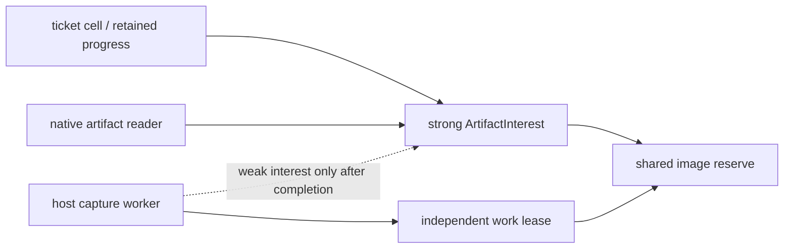

# Live capture의 요청·이미지·artifact 소유권

상태: runtime source 구현·집중 CPU 검증 중, renderer/host backend 전 · 2026-10-18 · P02/P03/DEV06

## 이 문서를 만든 이유

[실제 native 통합](../06-worklog/2026-10-18-native-host-integration.md)은 같은 창의 세대·pose·종료 metadata를 확인했지만 `pixel_capture=null`이다. AI가 mutation→Step→관찰을 같은 실행에서 수행하려면 실제 그 frame의 GPU readback이 필요하다. [전체 capture 계약](live-capture-and-artifacts.md)의 마지막 선행 과제인 ACK·timeout·GPU·파일·reader의 서로 다른 수명을 여기서 고정한다. 아직 capture operation이나 backend가 구현됐다는 뜻은 아니다.

source 감사는 현재 `RequestProgress`가 terminal result와 normal credit을 소유하고, `try_state`의 `Arc<RequestProgress>`가 ACK 뒤에도 살아 있을 수 있음을 확인했다. host는 coordinator·CPU worker·GPU owner 반환 경계를 이미 갖는다. 새 capture를 위해 session·Engine·preparation worker·ticket ledger를 하나 더 만들지 않는다.

## Runtime의 additive 경계

기존 `NativeProjectActivationService::start_with_render_consumer(options, config)`를 유지한다. sibling `start_with_render_consumer_and_capture(options, config)`는 같은 private start_mode·한 번 읽은 initial PreparedProject에서 `(service, generation_consumer_port, capture_handoff_port)`를 만든다. 기존 factory와 capture sink 없는 session은 CaptureUnavailable이며 Ready를 위조하지 않는다.

`SessionOperation::CaptureFrame { at_least_tick: Option<Tick>, timeout: Option<Duration> }`은 normal ticket으로 Queued→Terminal을 진행한다. world command/CommandId/AuthorityAccepted가 아니다. 기존 normal ticket reserve와 별도 image slot을 둘 다 얻어야 queue에 수락한다. image ceiling은 session당1개이며 Step reserved lane과 독립이다. timeout의 None은5초, 0/30초 초과는 거부한다. pixel/raw/PNG ceiling은 전체 계약을 따른다.

**Queue admission과 capture dispatch의 bind 시점을 구분한다.** `try_submit`은 actor 밖에서 실행되며 현재 authoritative generation/digest를 일관되게 읽는 기존 경계가 없다. 따라서 queue admission은 ID·deadline·normal/image reserve와 readiness를 고정하고, actor가 요청을 handoff로 dispatch하는 한 turn에서 자신의 실제 active generation/digest를 bind한다. `at_least_tick=None`의 floor는 그 turn의 실제 authority tick이다. explicit floor는 해당 최소 tick을 기다리며 actor를 막거나 Manual Step을 자동 실행하지 않는다. renderer 선택과 actor completion에서 source/currentness를 다시 검사한다. 오래된 latest-frame/render mailbox나 초기 ProjectInfo에서 source를 추측하지 않는다. 이는 client enqueue 시 source를 bind하려던 앞선 제안을 source 감사 뒤 수정한 것이다.

runtime 소유자의 API 제안을 root가 검토해 아래 경계와 factory/op/result로 구현 중이다. source review와 집중 CPU 검증 결과는 [runtime 작업 기록](../06-worklog/2026-10-18-live-capture-foundation.md)에 남긴다. 아직 최종 인수된 public API는 아니며, renderer/host backend의 dependent source 작성 전 검증된 type signature를 다시 공유한다.

| Type | 소유권과 공개 범위 |
| --- | --- |
| `CaptureArtifactId` | runtime이 admission 시 **전체 RequestTicketId(session/client/sequence)**에서 발급하는 opaque ID. sequence는 attachment별 값이므로 client를 생략하지 않음. 실패 뒤에도 ID를 재사용하지 않으며 public constructor 없음. |
| `CaptureImageLease`/`CaptureWorkLease` | 하나의 image reserve를 공유하는 구체적인 작은 token. clone은 새 slot을 만들지 않고 마지막 실제 소유자까지 반환을 늦춤. 임의 Drop callback 없음. |
| `CaptureArtifactCapability` | private `Arc<ArtifactInterest>`를 가진 Clone capability. interest가 image lease를 유지. ID/session getter만 제공하며 path/PNG payload/host type을 담지 않음. |
| `CaptureInterestWeak` | capability가 만든 concrete weak 관측자. 살아 있는 interest 확인과 동일 capability 검증만 제공. 임의 upgrade/공개 생성/콜백으로 새 소유권을 만들지 않음. |
| `CaptureRequest` | immutable identity·tick floor·deadline·취소와 capability·work lease를 가진 단일 accepted request. host가 durable worker/backstop에 넣은 뒤 renderer에 전달. |
| `CaptureResponder` | 예약된 capacity1 completion으로 actor에 한 번 완료. Drop/disconnect 시 typed failure 또는 actor의 확정된 deadline/close terminal 경로가 있어야 함. |
| `CaptureFrameResult` | exact selected frame/view/format·bounded PNG metadata·opaque capability. normal1MiB result에 image bytes/base64/임의 path를 넣지 않음. |

`SessionRequestResult`의 기존 Clone/Debug/PartialEq 성질을 무심코 깨지 않는다. capability 비교는 identity를 비교하되, reader 획득의 검증은 실제 interest/registry binding도 확인한다. debug 출력은 PNG bytes·사용자 경로·큰 backing을 덤프하지 않는다. compact result의 실제 byte ceiling과 정상/Step/image reserve rollback은 새 variant에서도 검증한다.

첫 `CaptureHandoffPort`는 `try_status`·`try_set_ready`·`try_set_unsupported`·`request_detach`·`try_take_request`의 nonwaiting 경계를 제공한다. Starting→Ready/Unsupported의 초기 보고는 한 번이며 Detached는 terminal이다. OOB request_detach는 idempotent 신호다. runtime native port는 신뢰 consumer 경계이며 CPU test의 Ready 보고를 실제 장치 capability로 보고하지 않는다. 실제 COPY_SRC/format 확인은 후속 renderer 소유다. responder loss는 private completion slot의 sender-interest 소멸로 actor가 감지해 typed terminal failure로 마감한다. UI callback에서 ticket cell mutex를 직접 호출하지 않는다.

`CaptureResponder::try_complete(&mut self, &CaptureCompletion)`은 nonwaiting 완료 시도이며 Busy일 때 caller가 같은 완료 payload와 responder를 보유한다. 성공은 한 번이다. receiver close와 completion을 일관된 순서로 처리해 이미 사라진 actor endpoint의 orphan slot에 성공을 쓰지 않는다. actor→handoff dispatch의 Busy/Detached도 원래 owned request를 돌려줘 cancel/terminal 처리 전에 capability/work lease가 조기 소멸하지 않게 한다.

순서는 capability/clock/limits→queue 여유→normal session/client reserve→image reserve→enqueue/ticket counter 고갈 확인→성공 enqueue다. 거부의 RAII rollback과 ID 비소비를 검증하며, full ID를 발급한 성공 admission 뒤에는 재사용하지 않는다. capture는 inspect 권한을 사용하며 기존 public `SessionCapabilities` 구조체/default를 바꾸지 않는다. 최소 CLI exhaustive-result arm은 컴파일/compact metadata만 연결하고 wire capture parser·artifact path·live_capture=true는 backend/실제 PNG 전까지 추가하지 않는다.

## Cycle 없는 image·file 수명

request가 GPU/encoder에 있는 동안 host의 durable record가 capability와 work lease를 보유한다. 성공 completion을 넘긴 뒤 registry는 strong interest를 계속 보유하지 않고 weak interest와 work lease만 유지한다. ticket cell·retained progress/result·native reader가 strong interest를 보유한다. registry→strong interest의 순환을 만들어 영원히 회수되지 않게 하지 않는다.

worker는 map/unmap·encoder·file 작업이 끝나고 strong interest도 사라진 뒤 spool을 삭제하고 마지막 work lease를 반환한다. timeout/forget/actor panic으로 ticket이 먼저 terminal이 되어도 GPU 작업이나 partial/final file이 남아 있으면 image slot은 반환되지 않는다. 반대로 normal result credit과 image credit을 같은 것으로 취급하지 않는다. image credit Drop은 작은 계수만 해제하고 file 삭제·큰 backing의 final drop은 worker에서 수행한다.

reader를 얻는 동안 typed capability의 strong interest를 유지한다. host/session/opaque ID와 registry의 실제 interest identity를 확인한다. serialized ID/path 복사만으로 reader나 새 소유권을 만들지 않는다. native reader는 capability를 유지하므로 ACK 뒤에도 안전하게 읽을 수 있다. host의 reader 획득은 작은 nonwaiting registry 조회와 lease 획득으로 만들고, file open/read/copy 같은 blocking 작업은 명시적 worker/caller I/O 경계에 둔다. window callback에서는 수행하지 않는다. CLI의 wire path는 안전한 실제 registry entry에서만 생성하며 lifetime은 ACK 전 또는 retained native capability에 한정한다.

## Coordinator 실패와 native 창 종료

accepted capture의 responder·work lease를 coordinator stack에만 두지 않는다. host의 bounded capture/encoder worker가 durable record1개를 먼저 소유하고 coordinator는 작은 key/status와 routing만 갖는다. 기존 facade Drop은 stop 요청만 하며, worker의 ownership은 facade/coordinator unwind 뒤에도 유지한다.

renderer에는 runtime dependency를 추가하지 않는다. renderer-owned scalar DTO와 독립 capacity1 request/completion lane으로만 연결한다. renderer는 runtime ticket·image lease·artifact capability·파일 path를 받지 않는다. readback buffer/map 상태와 실제 선택 metadata의 renderer owner를 반환하고, host가 runtime work lease와 결합해 유지한다.

기존 `ManagedWindowRun`→`GpuOwnerReturnSlot`→CPU owner worker 경로를 확장한다. GPU copy/map이 제출된 뒤에는 surface/window 종료와 readback의 실제 완료를 구분한다. owner drain은 pending readback을 nonwaiting poll하고 buffer view drop/unmap 또는 확인된 cancel 완료 전에 device owner를 조기 해제하지 않는다. packet/source pin은 기존 registry의 실제 사용 수명을 따른다.

PNG/file만 읽는 native artifact reader를 GPU frame/source pin으로 잘못 연결하지 않는다. readback 사용이 끝난 뒤 device/CPU backing은 기존 수명대로 회수할 수 있으며, artifact worker와 image slot은 마지막 capability/reader와 파일 정리가 끝날 때까지 남을 수 있다. `try_shutdown`은 이 잔류 상태를 Stopping으로 보고하고 finished worker만 join한다. reader를 영원히 보유하면 종료/slot 회복도 영원히 늦어질 수 있으며 강제 시간 상한이나 자동 reader 무효화를 선언하지 않는다.

capture worker의 per-job panic catch 바깥에 readback/work lease 소유자를 둔다. unwind로 token만 먼저 떨어지고 callback/GPU 작업이 남는 경로를 허용하지 않는다. callback은 작은 flag/try-send만 수행하며 encode/hash/I/O/큰 row copy/Wait/join을 하지 않는다. close·deadline·responder Drop·completion disconnect의 terminal 실패와 실제 자원 정리는 각각 관측한다.

## 후속 renderer handoff 감사

Luna의 읽기 전용 재검토는 기존 channel/server에 private optional lane을 추가하는 additive `managed_packet_window_capture_channel()` 형태를 제안했다. 반환은 기존 window client·별도 capture client·기존 server이며, frame/stage lane과 capture의 단일 request/completion 예약을 분리한다. 이는 아직 구현된 API가 아니다.

첫 renderer 완료는 **Submitted(readback)** 의미로 draw/copy 제출과 present() 호출 직후, map 완료 전에 host의 durable worker로 전달한다. move-only readback handle과 PacketRenderer의 private owner pin이 같은 readback state를 공유한다. host worker가 map flag를 확인하고 BufferView 생성/row copy/swizzle/해제/unmap을 수행한다. 여기서 try/read는 GPU 대기를 하지 않는다는 뜻이며 큰 CPU copy를 UI에서 실행해도 된다는 뜻이 아니다. 실제 unmap 상태까지 owner drain은 Pending이다.

readback handle Drop은 작은 abandon 신호만 보낸다. worker per-job guard와 반환된 GPU owner backstop이 실제 cleanup을 담당하며, CAS 등 상태 전환으로 worker가 BufferView를 가진 중에 owner가 unmap하지 못하게 한다. final buffer 해제·큰 backing 정리는 기존 CPU/encoder worker 경계에 두고 live window callback에 가져오지 않는다. callback·timeout·detach가 이 pin을 조기 해제하지 않는다. 최종 public state/cleanup-return signature는 renderer/host 구현 전에 동결한다.

Ready에는 실제 확인한 format과 **최대 크기/pixel ceiling**을 넣으며, 현재 창 크기는 selected-frame metadata에만 넣는다. resize마다 one-shot Ready를 갱신하지 않는다. 실제 COPY_SRC 미지원은 정상 presentation을 유지하며 Unsupported로 보고한다. 이 감사는 source feasibility이고 실제 장치 capability/PNG/owner drain 테스트 통과가 아니다.

## 구현 순서와 검증

1. **Runtime foundation**: exact API 동결→같은 service factory/handoff·normal/image admission·ticket terminal/cancel/deadline·capability/weak/work lease. CPU fake consumer는 handoff 계약 시험이며 실제 GPU capture 성공 근거가 아니다. production Ready/backend는 아직 없다.
2. **Renderer/host**: 실제 COPY_SRC capability와 같은 acquired frame의 draw→copy→present, async map·worker·registry·readers·owner drain을 연결한다. 정확한 DTO/return owner signature를 먼저 공유한다.
3. **CLI/실제 검증**: 기존 protocol2와 helper에 bounded result/artifact 접근을 연결한다. 같은 창에서 mutation→Step→capture→PNG decode/identity 대조→ACK→다음 capture를 검사한다. 별도 batch PNG로 대체하지 않는다.

필수 CPU 회귀는 ACK 뒤 retained progress, native reader 보유, work lease만 남은 시점의 slot 포화/회복, 실패 ID 비재사용, timeout 전후/중복 completion/responder loss, actor/coordinator/facade/worker panic·close 경합이다. 실제 ownership 전환과 observable admission/cleanup을 검사하고 Arc count만 흉내 내는 테스트로 대체하지 않는다. fixed tick/world mutation·Manual Step 포화 진행과 기존 없는-sink 동작도 회귀한다.

정확한 source 위치와 기존 factory/RequestProgress·host owner 순서는 [전체 capture 계약](live-capture-and-artifacts.md)의 source 감사와 PR20 source를 기준으로 대조했다. runtime→renderer/host dependency, 새 Engine, 임의 소멸 callback, UI blocking, release tag는 이번 작업 범위에 없다. D1·P02·P03의 전체 gate는 미완료다.
