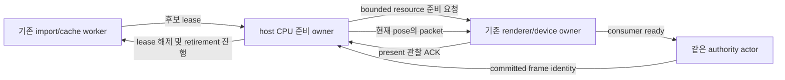

# P03.3b.3 같은 세션의 render 세대 준비·표시·회수

상태: source 조사 기반 상세 초안 · API/수치 동결 전 · 2026-10-16

## 문서 목적과 선행 게이트

[전체 activation 계약](project-asset-activation.md)의 renderer 부분을 실행 가능한 작업 경계로 좁힌다. [b.2 headless](headless-asset-generation.md)의 source commit은 실제 픽셀 교체가 아니다. b.2 lifecycle·통합 인수 뒤에 이 계약의 미결 API/예산을 리뷰·동결하고 Luna xhigh에 코드를 배정한다. 현재 구현 착수·b.2 또는 b.3 인수를 표시하지 않는다.

목표는 같은 Engine/SessionId·live pose를 유지하며 CPU 후보 준비→기존 device의 제한된 업로드→actor commit→새 generation의 실제 present 관찰→old CPU/GPU 회수를 연결하는 것이다. 새 renderer/device/캐시/프로토콜을 세대마다 만들지 않는다. 연결된 audio의 전환은 c의 별도 선행 조건이며 이 단계에서 audio를 붙인 채 준비를 생략해 성공시키지 않는다.

## 확인한 코드와 변경 경계

| 현재 source | 조사 결과 | 후속 책임 |
| --- | --- | --- |
| runtime `project_preparation.rs::StageResult`·reclamation registry | candidate는 actor-private Arc, worker는 실제 final drop backstop 유지 | control payload 반환 없이 native host에 bounded consuming lease 전달 |
| renderer `packet.rs::ProjectRenderResources::prepare/extract_with_view` | prepare는 borrowed project/handle map 사용, packet은 sidecar/handle Arc를 보유 | off-actor CPU 준비·source pin 전파·별도 prepared CPU 회수 장부 |
| `packet_renderer.rs::submit_packet_frame/commit_resources` | 전체 upload·draw·ready 교체가 같은 transaction | stage-only pump와 committed draw를 분리하되 cache/planner/ledger 공유 |
| `plan_resources/plan_cache_admission/plan_entry_victims` | 현재 후보를 active로 보는 victim 정책, GPU completion만으로 eviction 가능 | old-ready와 staged의 pin union·실제 retirement를 반영 |
| `note_submission/poll_retirement` | 공통 serial·completion watermark·bounded staging ledger | draw 없는 stage submission도 같은 한도·last-submission 장부 사용 |
| `window.rs`·CLI `project_view.rs` | `frame.present()` 뒤 final report는 있으나 live stage/present ACK 없음. outcome이 packet Arc를 유지한 채 coordinator join | bounded live ACK·small final metadata·큰 owner 해제와 종료 관찰 순서 |

이 표는 로컬 source 감사다. 장치 staging 시험이나 새 API 존재의 증거가 아니다. [S86](../02-research/source-register.md)은 고정 wgpu27.0.1의 callback/write/poll 의미를 별도로 확인한다.

## 소비자와 authority의 연결

화살표는 실행 중 handoff이며 crate dependency가 아니다. runtime→renderer dependency를 추가하지 않는다. headless factory의 기존 동작을 유지하고, 새 native-view 경로는 startup 때 필요한 render consumer를 선언한다. 시작 뒤 renderer를 임의로 붙여 이미 수락한 Commit의 의미를 바꾸지 않는다. CLI는 공통 native service/protocol2의 adapter이며 별도 activation engine을 소유하지 않는다.

기존 project-view coordinator는 input relay와 protocol pump도 맡는다. CPU prepare를 그 loop에서 통째로 실행하면 창이 계속 그려져도 입력/제어가 지연될 수 있다. 무거운 prepare는 별도의 bounded 작업으로 넘기고 coordinator는 작은 handoff/ACK를 처리한다. 기존 job pool 재사용 또는 장수하는 한 CPU 준비 owner의 정확한 선택·process worker 예산·취소/종료는 API 동결에 포함한다. 요청마다 detached thread를 생성하지 않는다.

Stage 수락·authored compatibility·CPU resource 준비·device staged·actor committed·submitted·present 관찰은 서로 다른 상태다. render consumer가 필요하면 device 준비가 확인되기 전 Commit을 허용하지 않는다. worker/device 결과와 ACK는 session/candidate/activation/generation/source identity를 검증하며 오래된 결과는 최신 작업에 적용하지 않는다. 같은 command replay/ACK/권한·효과 전 거부 규칙은 b.2를 유지한다.

## source lease와 두 종류의 CPU 메모리

native owner가 한 슬롯의 move-only `ProjectSourceLease`를 host로 전달하는 방향을 검토한다. 짧은 `with_source` borrowed callback은 기존 prepare에 필요한 `&PreparedProject`를 제공하고 control 결과/JSON에 payload를 넣지 않는다. runtime 내부는 같은 worker reclamation Arc를 유지한다. source와 renderer를 묶는 token은 downcast/Any/새 registry framework 없이 유지하는 방향이다. 정확한 factory·port·token API/반환 수명은 아직 동결하지 않았다.

`PreparedProject`는 기존 Clone 가능한 native type이다. borrowed 접근도 신뢰된 Rust SDK 경계이며 임의 caller의 clone/allocation까지 제한하는 sandbox가 아니다. 엔진 내부 구현은 명시적 소유권 장부를 따른다. [S87](../02-research/source-register.md)에 따라 auto-trait-only `Arc<dyn Send + Sync>` 자체는 원천적으로 금지된 문법이 아니다. 공유 marker trait가 반드시 필요하다고 가정해 새 crate 경계를 만들지 않는다. 고정 Rust1.94 실제 compile·Debug wrapper 등 API 검증은 후속 Luna 작업으로 남긴다.

source pin은 actual source-backed MeshHandle/ModelTextureUpload와 packet sidecar까지 이어져야 한다. wrapper만 pin하고 validation/resource plan이 독립 Arc를 들고 있게 두면 charge를 먼저 반환할 수 있다. 모든 엔진 내부 pending/ready packet·validation·staging plan·presentation outcome을 owner graph에 포함한다. token이 자신을 보유한 renderer backing을 다시 소유하는 순환 참조는 금지한다.

renderer가 따로 만든 legacy mesh Vec·prepared template/map·sidecar metadata는 source pin만으로 final drop thread나 별도 예산이 해결되지 않는다. source cooked 장부와 prepared CPU 장부를 구분하고, prepared generation의 cleanup backstop도 off-actor owner에 둔다. packet/plan이 계속 보유 중이면 wrapper 교체만으로 회수를 보고하지 않는다. 기존 estimator가 무엇을 논리적으로 세는지·실제 공유인지·별도 복사본인지 리뷰해 aggregate 수치를 확정한다. CPU 예산을 GPU byte 수나 전체 RSS로 바꾸어 부르지 않는다.

종료 때 window outcome의 last-presented packet Arc를 유지한 채 cleanup을 기다리는 coordinator에 blocking join하면 순환 대기가 가능하다. 최종 작은 identity/view/report를 먼저 복사하고 큰 packet/outcome/device owner를 해제한 뒤 finished를 관찰하거나, 참조가 남으면 정직하게 Stopping을 유지한다. 아직 끝나지 않은 thread를 UI에서 join하지 않는다. native caller가 의도적으로 유지한 resource lease도 종료 계약에 명시한다.

## 장치 준비와 기존 정상 화면 유지

후보의 전체 resource/count·residency·upload/scratch 필요량을 먼저 검증·예약한다. 기존 `submit_packet_frame`을 stage API처럼 부르면 실제 draw/active 교체가 먼저 일어나므로 그대로 사용하지 않는다. pose와 무관한 immutable resource set 또는 검증된 candidate packet 중 어느 입력을 stage API로 받을지 먼저 정한다. stage를 위해 authority Step을 실행하지 않는다.

candidate의 개별 working set은 기존 상한을 따르고, old-ready·staged·아직 완료되지 않은 retired 자원은 같은 hard ceiling 안에 있어야 한다. 동일 geometry payload/layout·texture/sampler/bind-group key는 GPU cache의 실제 기존 자원을 재사용한다. key가 같다는 사실만으로 별도 CPU allocation도 공유한 것으로 계산하지 않는다. old-ready와 staged pin은 GPU 작업이 완료됐더라도 임의 LRU victim으로 선택하지 않는다.

업로드의 자연스러운 작업 단위는 다음과 같다. 수치는 현재 layout이며 pump 기본 작업량은 제안/리뷰 전이다.

| 작업 | 현재 source에서 확인한 단위 | 후속 조건 |
| --- | --- | --- |
| imported geometry | 32-byte GpuModelVertex·4-byte u32 index | 전체 배열을 한 번에 pack하지 않고 record 경계의 범위 cursor. buffer offset/크기 alignment 유지 |
| legacy geometry | 실제 Vertex stride·u32 index | 실제 layout별 whole-record 범위, 같은 staging 경로 사용 |
| texture | mip index·RGBA row 범위, 현재 최대4096축의 row는16KiB | mip/첫 row/row count cursor. queue.write_texture와 buffer-copy의 row 정렬 차이·보수적 staging charge 구분 |
| texture/sampler/bind group 생성 | device resource 개수 | byte 한도와 별개로 pump별 생성 개수 제한. 큰 생성 호출의 시간 상한은 보장하지 않음 |

각 pump는 nonwaiting completion poll→허용된 작은 작업→필요한 stage submit/serial 등록으로 진행한다. write만 하고 stage 완료로 기록하지 않는다. draw 없는 submission과0-byte submission도 실제 수행하면 공통 in-flight 장부에 포함한다. GPU callback은 serial/watermark 같은 작은 metadata만 게시하며 큰 backing의 마지막 drop을 맡기지 않는다.

## 기존 ceiling과 동결할 scheduling 정책

| scope | 현재 상한 | staged 경로의 조건/미결 |
| --- | --- | --- |
| GPU geometry | preferred64MiB/hard128MiB, active256/total512 meshes | 기존 active의 preferred와 retained union의 hard를 구분 |
| 전체 GPU residency | working128MiB/hard256MiB | active/candidate 개별 working, retained union/hard 적용을 수치 리뷰 후 동결 |
| texture/sampler/bind group | active256/256/1024, total512/512/2048 | old+staged+incomplete retired 포함·완료된 unpinned cache만 eviction |
| staging·CPU upload scratch | 각각128MiB, bookkeeping8MiB | stage 별도 무제한 queue/예산 금지. 구체 upload path의 논리적 byte 장부 사용 |
| in-flight submission | 최대3 | stage batch 최대1개와 last-good presentation 여유·공정성. reduced limit1의 동시 진행은 보장할 수 없음 |
| prepared CPU | 기존 per-project geometry64MiB/metadata8MiB | aggregate128MiB/16MiB는 전체 activation 문서의 제안. 실제 별도 backing/공유·retired를 리뷰해 확정 |

stage가 마지막 presentation 여유 슬롯/bytes를 모두 소비하지 않게 예약한다. byte 예약은 last-good의 다음 실제 write plan과 보수적인 frame-update 상한을 구분한다. 낮춘 시험 상한에서 staging/presentation 둘 다 진행할 수 없는 config를 거부할지, 제한된 모드로 명시할지 API 동결 때 결정한다. pump byte/생성 개수 기본값·fairness·max-in-flight 최소값은 아직 미결이다. 1ms/144fps·특정 완료 시간을 보장하지 않는다.

## commit·표시와 실패

device staged 전에는 active source/slot bindings/last-good packet을 교체하지 않는다. 이후 같은 actor가 Commit한 frame identity로 현재 live pose를 추출한다. b.2 publication sequence와 authority snapshot sequence를 구분하고 renderer에도 explicit publication ordering을 전달한다. source generation 증가만 허용하려고 같은 packet sequence 검사를 풀지 않는다.

제출 성공만으로 old-ready pin을 풀지 않는다. 새 committed generation의 `frame.present()` 이후 live ACK와 GPU completion/실제 남은 CPU owner를 각각 확인한다. present 관찰은 엔진의 surface present 호출 경계이며 OS compositor의 물리적 scanout/가시성 측정이라는 보장은 아니다. acquire 뒤 drop·제출만 성공한 frame은 presented로 기록하지 않는다.

효과 전 topology/지원 범위·working-set 초과는 typed candidate 실패, 일시적 pin/in-flight 부족은 Busy/Pending으로 구분한다. partial upload 뒤 취소/실패한 자원도 해당 completion serial 전에는 실제 eviction/charge 반환을 하지 않는다. 기존 정상 packet/slot은 보존한다. device loss/OOM 같은 fatal 오류는 실제 실패로 보고하며 정상 표시로 위장하지 않는다. commit 뒤 표시 지연/실패는 committed와 presented identity를 따로 보고하고 world/source generation을 되감지 않는다.

## 인수와 다음 동결 목록

같은 live view/session에서 PNG/model/atlas 변경의 실제 픽셀과 current pose·generation/source ACK를 대조한다. unchanged/transform-only·image-only·node-only별 geometry/texture upload delta를 기록하고 취소·stale·예산 거부·partial completion 지연·held old packet 뒤 last-good/회수/입력·Step 진행을 검증한다. 기존 Metal/CPU/managed/native 회귀와 clean package·다섯 CI/main 동일 tree는 별도 실제 근거로 유지한다. batch capture나 synthetic handle fixture만으로 live 전환을 인수하지 않는다.

- [ ] b.2 predecessor 인수와 필요한 native factory/consumer port·단일 lease/ACK 용량.
- [ ] source retention token·prepared CPU cleanup owner graph와 실제 final-drop/byte 회계.
- [ ] immutable stage 입력·public stage/pump/commit/cancel/status API 및 typed 오류·ID.
- [ ] pump 작업량·resource 생성 수·submission/byte 예약·낮춘 config/fairness.
- [ ] 실제 present ACK·post-commit 실패·최종 outcome 해제/종료 순서.
- [ ] CLI/protocol2 확장·같은 fixture/helper 재사용·Luna 파일/manifest/Cargo owner.

위 항목을 먼저 동결한 뒤 구현한다. 이 상세 초안과 소스 조사는 b.3이나 D1/D2/D3 통과 근거가 아니다.
