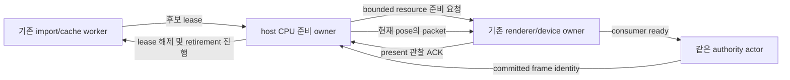

# P03.3b.3 같은 세션의 render 세대 준비·표시·회수

상태: source 대조 후 구체 설계안 · API/수치 최종 동결 전 · 2026-10-17

## 문서 목적과 선행 게이트

[전체 activation 계약](project-asset-activation.md)의 renderer 부분을 실행 가능한 작업 경계로 좁힌다. [b.2 headless](headless-asset-generation.md)는 PR16/main360ceb6에서 인수했지만 source commit이 실제 픽셀 교체는 아니다. [runtime consumer](project-generation-consumer.md) 경계는 먼저 동결했으며 이 renderer의 미결 API/예산은 리뷰 후 해당 코드 작업을 배정한다. runtime port 구현만으로 이 renderer나 b.3를 인수하지 않는다.

목표는 같은 Engine/SessionId·live pose를 유지하며 CPU 후보 준비→기존 device의 제한된 업로드→actor commit→새 generation의 실제 present 관찰→old CPU/GPU 회수를 연결하는 것이다. 새 renderer/device/캐시/프로토콜을 세대마다 만들지 않는다. 연결된 audio의 전환은 c의 별도 선행 조건이며 이 단계에서 audio를 붙인 채 준비를 생략해 성공시키지 않는다.

## 확인한 코드와 변경 경계

| 현재 source | 조사 결과 | 후속 책임 |
| --- | --- | --- |
| runtime `project_preparation.rs::StageResult`·reclamation registry | candidate는 actor-private Arc, worker는 실제 final drop backstop 유지 | control payload 반환 없이 native host에 bounded consuming lease 전달 |
| renderer `packet.rs::ProjectRenderResources::prepare/extract_with_view` | prepare는 borrowed project/handle map 사용, packet은 sidecar/handle Arc를 보유 | off-actor CPU 준비·source pin 전파·별도 prepared CPU 회수 장부 |
| `packet_renderer.rs::submit_packet_frame/commit_resources` | 전체 upload·draw·ready 교체가 같은 transaction | candidate 준비 상태는 분리하되 bounded stage chunk와 old-ready draw는 한 submit으로 조합 |
| `plan_resources/plan_cache_admission/plan_entry_victims` | 현재 후보를 active로 보는 victim 정책, GPU completion만으로 eviction 가능 | old-ready와 staged의 pin union·실제 retirement를 반영 |
| `note_submission/poll_retirement` | 공통 serial·completion watermark·bounded staging ledger | stage write와 old-ready draw의 한 serial·공통 last-submission 장부 사용 |
| `window.rs`·CLI `project_view.rs` | `frame.present()` 뒤 final report는 있으나 live stage/present ACK 없음. outcome이 packet Arc를 유지한 채 coordinator join | bounded live ACK·small final metadata·큰 owner 해제와 종료 관찰 순서 |

이 표는 로컬 source 감사다. 장치 staging 시험이나 새 API 존재의 증거가 아니다. [S86](../02-research/source-register.md)은 고정 wgpu27.0.1의 callback/write/poll 의미를 별도로 확인한다.

## 소비자와 authority의 연결

화살표는 실행 중 handoff이며 crate dependency가 아니다. runtime→renderer dependency를 추가하지 않는다. headless factory의 기존 동작을 유지하고, 새 native-view 경로는 startup 때 필요한 render consumer를 선언한다. 시작 뒤 renderer를 임의로 붙여 이미 수락한 Commit의 의미를 바꾸지 않는다. CLI는 공통 native service/protocol2의 adapter이며 별도 activation engine을 소유하지 않는다.

기존 project-view coordinator는 input relay와 protocol pump도 맡는다. CPU prepare를 그 loop에서 통째로 실행하면 창이 계속 그려져도 입력/제어가 지연될 수 있다. 무거운 prepare는 별도의 bounded 작업으로 넘기고 coordinator는 작은 handoff/ACK를 처리한다. 기존 job pool 재사용 또는 장수하는 한 CPU 준비 owner의 정확한 선택·process worker 예산·취소/종료는 API 동결에 포함한다. 요청마다 detached thread를 생성하지 않는다.

추가 source 감사에서 현재 pool을 host가 그대로 재사용할 수 없는 이유를 확인했다. `EngineBuilder::build`의 per-engine `TaskPool`은 기본 worker1/capacity64지만 `SessionControlService`는 Engine/tasks handle을 외부에 공개하지 않는다. `TaskPool::try_recv`는 하나의 shared completion receiver이며 fixture `LiveSession`은 자신의 job map에 없는 결과를 오류로 처리한다. 결과 owner/broker 없이 다른 poller를 연결하는 것은 안전한 재사용이 아니다. 현재 `ProjectRenderResources::prepare`에도 cooperative cancellation 입력이 없다. 전체 prepare를 pool로 옮기는 것만으로 빠른 취소를 보장하지 않는다.

우선 검토안은 장수하는 render CPU owner 하나를 host 예산/진단에 별도로 포함하고 취소 checkpoint·한 개 candidate lease·유한 handoff를 두는 것이다. 최신 desired metadata를 보관하더라도 두 번째 큰 candidate payload를 장부 밖에 대기시키지 않는다. 현재 preparation owner도 Engine task-worker 진단과 별도인 점을 유지해 process 전체를 이미 제한한다고 주장하지 않는다. public `EngineConfig` literal에 임의 field를 추가하지 않고 host 옵션/진단 경계를 동결한다.

또한 runtime-neutral port와 renderer 자원 owner만으로는 현재 CLI에 있는 input/protocol/presentation 조합이 SDK 기능으로 재사용되지 않는다. [native project host](native-project-host.md)는 runtime→renderer 의존 없이 두 계층을 조합하는 작은 library와 CLI adapter의 구체안이다. 기존 코드·책임을 재사용하며 일반 scheduler/actor framework를 추가하지 않는다. crate 이름·최종 facade·source 이동은 코드 전 리뷰 대상이고 아직 구현하지 않았다.

Stage 수락·authored compatibility·CPU resource 준비·device staged·actor committed·submitted·present 관찰은 서로 다른 상태다. render consumer가 필요하면 device 준비가 확인되기 전 Commit을 허용하지 않는다. worker/device 결과와 ACK는 session/candidate/activation/generation/source identity를 검증하며 오래된 결과는 최신 작업에 적용하지 않는다. 같은 command replay/ACK/권한·효과 전 거부 규칙은 b.2를 유지한다.

## source lease와 두 종류의 CPU 메모리

native owner가 한 슬롯의 move-only `ProjectSourceLease`를 host로 전달하는 방향을 검토한다. 짧은 `with_source` borrowed callback은 기존 prepare에 필요한 `&PreparedProject`를 제공하고 control 결과/JSON에 payload를 넣지 않는다. runtime 내부는 같은 worker reclamation Arc를 유지한다. source와 renderer를 묶는 token은 downcast/Any/새 registry framework 없이 유지하는 방향이다. 정확한 factory·port·token API/반환 수명은 아직 동결하지 않았다.

`PreparedProject`는 기존 Clone 가능한 native type이다. borrowed 접근도 신뢰된 Rust SDK 경계이며 임의 caller의 clone/allocation까지 제한하는 sandbox가 아니다. 엔진 내부 구현은 명시적 소유권 장부를 따른다. [S87](../02-research/source-register.md)의 auto-trait-only `Arc<dyn Send + Sync>` coercion/clone·opaque Debug wrapper와 unsized Arc의 strong/Weak 해제 뒤 worker final-drop을 Rust1.94 설계 probe에서 확인했다. 기존 `PacketRenderer`·`PacketViewSubmission`·`ProjectRenderResources`의 Send, `RenderPacket`의 Send+Sync도 compile 확인했다. [작업 기록](../06-worklog/2026-10-17-native-host-design.md)의 3건은 새 host API·실제 GPU 이동/회수의 통과가 아니다. 새 공통 marker crate가 반드시 필요하다고 가정하지 않는다.

source pin은 actual source-backed MeshHandle/ModelTextureUpload와 packet sidecar까지 이어져야 한다. wrapper만 pin하고 validation/resource plan이 독립 Arc를 들고 있게 두면 charge를 먼저 반환할 수 있다. 모든 엔진 내부 pending/ready packet·validation·staging plan·presentation outcome을 owner graph에 포함한다. token이 자신을 보유한 renderer backing을 다시 소유하는 순환 참조는 금지한다.

GPU key 재사용과 CPU handle 공유는 구분한다. 여러 세대에서 같은 CPU handle을 재사용하면서 그 내부 token이 첫 source 전체를 계속 붙잡으면, 이전 세대 packet을 모두 해제해도 현재 handle이 old source를 유지해 retired 슬롯을 영구 점유할 수 있다. 이는 구현에서 확인한 결함이 아니라 owner graph의 검토 조건이다. 초기 경로는 세대별 CPU owner/pin을 명시하고 GPU 자원만 content key로 재사용하는 방향부터 검토한다. CPU backing까지 세대 간 공유하려면 actual Arc·별도 charge·마지막 큰 drop과 다음 연속 교체의 진행을 함께 증명한다. wrapper의 token만 바꾸고 내부 leaf Arc를 장부 밖에 남기는 방식도 허용하지 않는다.

renderer가 따로 만든 legacy mesh Vec·prepared template/map·sidecar metadata는 source pin만으로 final drop thread나 별도 예산이 해결되지 않는다. source cooked 장부와 prepared CPU 장부를 구분하고, prepared generation의 cleanup backstop도 off-actor owner에 둔다. 실제 공유될 각각의 backing Arc를 handoff 전에 등록한다. root wrapper만 보유해서는 안 된다. legacy MeshResource·model draw slice·model/sprite map·sprite order·per-packet instances·`validated_normals: Arc<OnceLock<...>>`를 포함한다. 현재 `RenderPacket: Clone`과 renderer의 `packet.clone()` 경로는 root와 독립적인 leaf alias를 만들 수 있다.

parent map/template부터 해제한 뒤 leaf를 worker에서 회수한다. Sized Arc는 try_unwrap, unsized slice는 get_mut로 strong alias와 Weak 부재를 확인한 뒤 worker drop하는 방향이다. normal cache의 OnceLock은 lazy 값이 생기기 전부터 canonical backing을 등록한다. packet/plan이 계속 보유 중이면 wrapper 교체만으로 회수를 보고하지 않는다. instances/normal cache는 per-source 준비 비용과 별도의 bounded frame 비용이다. [host의 CPU lane 제안](native-project-host.md)에 legacy copy·metadata·frame·scratch를 분리하고 frame16MiB/aggregate48MiB·unique3개를 제안했다. CPU-validated input을 retain하면 별도 normal map도 포함해야 한다. capacity·HashMap 오버헤드·held alias·등록 슬롯의 estimator는 코드 전 수치 동결 대상이다. GPU bookkeeping8MiB나 전체 RSS를 이 CPU budget 대신 부르지 않는다.

종료 때 window outcome의 last-presented packet Arc를 유지한 채 cleanup을 기다리는 coordinator에 blocking join하면 순환 대기가 가능하다. 최종 작은 identity/view/report를 먼저 복사하고 큰 packet/outcome/device owner를 해제한 뒤 finished를 관찰하거나, 참조가 남으면 정직하게 Stopping을 유지한다. 아직 끝나지 않은 thread를 UI에서 join하지 않는다. native caller가 의도적으로 유지한 resource lease도 종료 계약에 명시한다.

## 장치 준비와 기존 정상 화면 유지

후보의 전체 resource/count·residency·upload/scratch 필요량을 먼저 검증·예약한다. 기존 `submit_packet_frame`을 stage API처럼 부르면 실제 draw/active 교체가 먼저 일어나므로 그대로 사용하지 않는다. **pose와 무관한 resource-only 입력**을 사용하는 구체안으로 좁힌다. `ProjectRenderResources`는 이미 세대별 handle/template/binding을 갖는다. entity binding에서 실제 참조하는 geometry/model/sprite 요청만 수집하며, 사용하지 않는 catalog 전체나 `prepared_geometry_bytes`를 active set으로 쓰지 않는다. stage를 위해 authority Step이나 가짜 tick/publication/pose를 만들지 않는다.

기존 `plan_resources`는 geometries·model_bindings·sprite_bindings를 읽으며 normal_matrices는 읽지 않는다. 작은 private borrowed `ResourceRequests` projection을 두어 기존 PacketValidation과 새 owned stage input이 같은 planner/cache admission을 쓰게 한다. 범용 trait framework나 별도 stage planner를 복제하지 않는다. geometry key·texture key·sampler key·texture/sampler pair·default texture·sprite quad·expanded draw 수·필요 model/sprite pipeline은 준비 대상이다. tint·material/UV row·painter order와 live transform은 그릴 frame의 데이터다.

| 제안 operation | 입력/효과 |
| --- | --- |
| CPU stage-input 생성 | ProjectRenderResources에서 validated immutable descriptor와 source pin 구성. 실제 publication을 요구하지 않음 |
| `begin_stage` | renderer-local opaque PacketStageId 발급, whole-candidate admission/union pin·예약. host가 runtime identity와 대응. GPU 생성은 이 호출에서 일괄 실행하지 않음 |
| stage status/poll/cancel | nonwaiting 완료 조회·bounded metadata·취소. 동일 ID 재시도/이미 종료된 ID 의미는 최종 API에서 동결 |
| old-ready draw + optional stage chunk | 한 surface/target draw에 허용된 작은 upload/생성 작업을 조합. normal PacketViewSubmission과 stage progress를 반환 |
| initial bootstrap draw + optional stage chunk | old-ready가 없을 때 같은 device의 clear/loading pass와 조합. game packet/submission identity나 presented ACK를 꾸미지 않음 |
| committed draw | actor의 실제 committed frame에서 새 packet 추출. session/generation/digest와 canonical resource keys가 staged 입력과 일치하는지 검증 후 표시 |

ready 전에 required model/sprite pipeline과 target format/sRGB 처리를 검증한다. 실제 committed packet의 tick·publication·pose는 준비 때보다 진행해도 된다. staged identity가 같다고 예상하지 않은 새 resource key를 즉석 일괄 업로드하지 않는다. API 이름·반환 type은 구체 제안이며 아직 public symbol이 아니다.

이 계약의 replacement는 old-ready packet을 쓰지만 generation1에는 그것이 없다. additive packet-window bootstrap은 clear-only 또는 기존 loading overlay를 그리고 같은 한 submit에 initial upload chunk를 싣는다. bootstrap present는 game present가 아니다. initial device-ready 뒤에만 actor의 실제 최신 initial-generation frame을 추출해 첫 정상 game draw/present·ACK를 수행한다. 이미 있는 source generation1을 candidate ID나 새 Commit으로 위장하지 않는다. 현재 packet-window 생성자는 initial packet을 요구하며 legacy Scene fallback은 이 새 기능이 아니다. 초기 CPU project load 이전의 전체 loading UI는 [host 문서](native-project-host.md)의 별도 미완료 경계로 유지한다.

candidate의 개별 working set은 기존 상한을 따르고, old-ready·staged·아직 완료되지 않은 retired 자원은 같은 hard ceiling 안에 있어야 한다. 동일 geometry payload/layout·texture/sampler/bind-group key는 GPU cache의 실제 기존 자원을 재사용한다. key가 같다는 사실만으로 별도 CPU allocation도 공유한 것으로 계산하지 않는다. old-ready와 staged pin은 GPU 작업이 완료됐더라도 임의 LRU victim으로 선택하지 않는다.

업로드의 자연스러운 작업 단위는 다음과 같다. 수치는 현재 layout이며 pump 기본 작업량은 제안/리뷰 전이다.

| 작업 | 현재 source에서 확인한 단위 | 후속 조건 |
| --- | --- | --- |
| imported geometry | 32-byte GpuModelVertex·4-byte u32 index | 전체 배열을 한 번에 pack하지 않고 record 경계의 범위 cursor. buffer offset/크기 alignment 유지 |
| legacy geometry | 현재24-byte GpuVertex·4-byte u32 index | 실제 layout별 whole-record 범위, 같은 staging 경로 사용 |
| texture | mip index·RGBA row 범위, 현재 최대4096축의 row는16KiB | mip/첫 row/row count cursor. queue.write_texture와 buffer-copy의 row 정렬 차이·보수적 staging charge 구분 |
| texture/sampler/bind group/pipeline 생성 | 실제 create_* 호출 수 | byte 한도와 별개로 pump별 생성 개수 제한. texture view·shader module·pipeline/layout도 포함. 큰 생성 호출의 시간 상한은 보장하지 않음 |

각 pump는 nonwaiting completion poll→old-ready draw와 작은 stage chunk의 preflight→한 queue submit/serial 등록으로 진행한다. window에서는 surface acquire를 먼저 수행한다. 필요한 CPU 검증·예산·frame write와 chunk·GPU object 준비를 queue.write_* 전에 확정한다. acquire/효과 전 preflight가 실패하면 write를 enqueue하거나 cursor를 진행하지 않는다. write 뒤 예외/fatal이 생기는 경로는 실제 pending write/charge를 숨기지 않고 drain/실패로 수렴해야 한다.

wgpu의 queue.write_*는 다음 submit에 연동되므로 stage write만 enqueue해 두고 다른 draw가 우연히 제출하기를 기다리지 않는다. 한 combined submit의 serial을 touched stage 자원과 old-ready draw 자원 모두에 기록한다. GPU callback은 serial/watermark 같은 작은 metadata만 게시하며 큰 backing의 마지막 drop을 맡기지 않는다.

초기 scheduler 제안은 **pump당4MiB upload·candidate에 추가되는 실제 GPU 생성8회 이하, stage chunk는 최대1개 outstanding**이다. 성능 실측값이 아니다. 기존 draw/target 처리 비용까지8회로 제한한다는 뜻은 아니다. quota는 ensure_model_pipeline 호출을1회로 세지 않는다. 현재 최초 model/sprite ensure는 shared bind-group layout이 없으면1회와 pipeline layout·shader module·render pipeline 각1회가 필요하다. 공유 layout이 이미 있으면 각각3회다. 의존 atomic group이 남은 quota에 맞지 않으면 다음 pump로 미루며, config 자체가 최소 group보다 작으면 효과 전 오류로 거부한다. 모든 자원의 GPU allocation은 byte chunk와 달리 전체 크기로 생성되므로4MiB가 allocation/driver 시간 상한이라는 뜻은 아니다.

## 기존 ceiling과 동결할 scheduling 정책

| scope | 현재 상한 | staged 경로의 조건/미결 |
| --- | --- | --- |
| GPU geometry | preferred64MiB/hard128MiB, active256/total512 meshes | 기존 active의 preferred와 retained union의 hard를 구분 |
| 전체 GPU residency | working128MiB/hard256MiB | active/candidate 개별 working, retained union/hard 적용을 수치 리뷰 후 동결 |
| texture/sampler/bind group | active256/256/1024, total512/512/2048 | old+staged+incomplete retired 포함·완료된 unpinned cache만 eviction |
| staging·CPU upload scratch | 각각128MiB, bookkeeping8MiB | stage 별도 무제한 queue/예산 금지. 구체 upload path의 논리적 byte 장부 사용 |
| in-flight submission | 기본 최대3, 기존 유효한1/2 유지 | stage+old-ready draw는 한 slot 사용. stage chunk outstanding 최대1. max1이면 이전 submit 완료 뒤 다음 combined draw, max2도 별도 stage slot 불필요 |
| prepared CPU | 기존 per-project geometry64MiB/metadata8MiB | aggregate128MiB/16MiB는 전체 activation 문서의 제안. 실제 별도 backing/공유·retired를 리뷰해 확정 |

별도 stage-only submission을 위해 최소3 slots를 강제하거나 presentation slot을 빼앗지 않는다. stage chunk의 이전 serial이 미완료면 그리는 일은 허용하되 새 stage chunk를 만들지 않는다. max1에서 기존 submit이 미완료인 동안 draw도 원래 in-flight Busy이며 completion 이후 combined 경로가 진행한다. initial의 clear/loading pass도 같은 장부/slot 규칙을 따른다. native surface가 hidden/minimized/acquire 불가면 첫 native 경로는 GPU stage도 보류하고 CPU/취소/stop은 진행한다. surface 없는 stage 진행이 필요하면 별도 offscreen scheduling 계약으로 추가하며 D1 headless 요구를 삭제하지 않는다.

byte admission은 현재 실제 frame write+허용 chunk+미완료 장부를 함께 세며, 다음 old-ready frame의 보수적 write 여유를 남긴다. 현재 선언의 GpuInstance128·MaterialUniform48·SpriteUvUniform16·GlobalsUniform128·OverlayUniform16을 기준으로 `max_instances × (128+48+16) + 128+16`이다. 기본16384에서 **3,145,872bytes**이며 source layout 산술이고 실측 성능이 아니다. 코드는 checked size_of 기반으로 계산해 layout 변경을 따라야 한다. 작은 config도 같은 식을 따른다.

일시적으로 in-flight bytes가 부족하면 old-ready만 그리고 chunk를 미룬다. 빈 장부에서도 한 whole-record/whole-row·필요 frame 예약이 영구히 맞지 않는 config는 typed budget/config 오류이며 Busy를 무한 반환하지 않는다. texture upload charge는 보수적으로256-row-pitch를 적용하되 Queue.write_texture 자체에 buffer-copy와 같은256 정렬 요구가 있다고 설명하지 않는다. 구체 API·frame CPU accounting·추가 할당 경계의 수치 최종 리뷰는 남아 있다. 1ms/144fps·특정 완료 시간을 보장하지 않는다.

## commit·표시와 실패

device staged 전에는 active source/slot bindings/last-good packet을 교체하지 않는다. 이후 같은 actor가 Commit한 frame identity로 현재 live pose를 추출한다. b.2 publication sequence와 authority snapshot sequence를 구분하고 renderer에도 explicit publication ordering을 전달한다. source generation 증가만 허용하려고 같은 packet sequence 검사를 풀지 않는다.

제출 성공만으로 old-ready pin을 풀지 않는다. 새 committed generation의 `frame.present()` 이후 live ACK와 GPU completion/실제 남은 CPU owner를 각각 확인한다. present 관찰은 엔진의 surface present 호출 경계이며 OS compositor의 물리적 scanout/가시성 측정이라는 보장은 아니다. acquire 뒤 drop·제출만 성공한 frame은 presented로 기록하지 않는다.

효과 전 topology/지원 범위·working-set 초과는 typed candidate 실패, 일시적 pin/in-flight 부족은 Busy/Pending으로 구분한다. **업로드 범위 완성 여부와 GPU serial 완료는 별개다.** 새 buffer/texture는 모든 필요한 record/row/mip가 채워지고 final serial도 완료되기 전까지 일반 ready cache hit가 아니다. 같은 content key라는 이유로 불완전 자원을 사용하지 않는다.

취소/실패는 다음 chunk를 중단하며 partial 자원도 마지막 실제 serial 완료까지 charge/pin을 보존한다. 첫 구현안은 incomplete 객체를 그 뒤 폐기하고 새 시도에서 재생성한다. fence 완료만으로 incomplete를 ready 승격하지 않는다. 기존 complete key를 재사용한 자원은 기존 정상 상태를 유지한다. 기존 정상 packet/slot은 보존한다. device loss/OOM 같은 fatal 오류는 실제 실패로 보고하며 정상 표시로 위장하지 않는다. commit 뒤 표시 지연/실패는 committed와 presented identity를 따로 보고하고 world/source generation을 되감지 않는다.

## 인수와 다음 동결 목록

같은 live view/session에서 PNG/model/atlas 변경의 실제 픽셀과 current pose·generation/source ACK를 대조한다. unchanged/transform-only·image-only·node-only별 geometry/texture upload delta를 기록하고 취소·stale·예산 거부·partial completion 지연·held old packet 뒤 last-good/회수/입력·Step 진행을 검증한다. 기존 Metal/CPU/managed/native 회귀와 clean package·다섯 CI/main 동일 tree는 별도 실제 근거로 유지한다. batch capture나 synthetic handle fixture만으로 live 전환을 인수하지 않는다.

- [ ] b.2 predecessor 인수와 필요한 native factory/consumer port·단일 lease/ACK 용량.
- [ ] source retention token·prepared CPU cleanup owner graph와 실제 final-drop/byte 회계.
- [ ] resource-only stage 입력·공유 ResourceRequests planner·public API 및 typed 오류·ID.
- [ ] combined submit·pump4MiB/생성8회 제안·다음 frame byte 예약·낮춘 config/fairness와 partial completeness.
- [ ] 실제 present ACK·post-commit 실패·최종 outcome 해제/종료 순서.
- [ ] CLI/protocol2 확장·같은 fixture/helper 재사용·Luna 파일/manifest/Cargo owner.

위 항목을 먼저 동결한 뒤 구현한다. 이 상세 초안과 소스 조사는 b.3이나 D1/D2/D3 통과 근거가 아니다.
