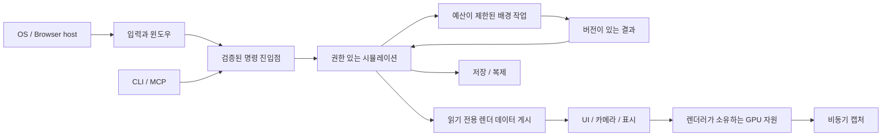

# 시스템 경계와 엔진 모듈

상태: 아키텍처 초안. 모듈명은 제안이며 Cargo workspace 미생성 · 2026-10-15

## 설계 목표

REQ-001~007과 REQ-010을 만족하도록 공통 실행·데이터 계약을 차원별 월드·표현에서 분리한다. 이 문서의 모듈은 모두 엔진 기능이다. 2D·3D 샘플 게임을 저장소에 만드는 계획이 아니다.

```text
Daedalus
  platform        네이티브 창 / 웹 호스트 / 시계 / 저장 어댑터
  core            ID / 오류 / 시간 / 설정 / 수명
  tasks           실행 예산 / 작업 / 취소 / 결과
  world           ECS 통합 / 장면 / 변환 / 명령
  presentation    로컬 UI 상태 / 표시 시계 / 렌더 추출
  render          wgpu / 그래프 / 재질 / 2D / 3D / GPU 자원
  assets          import 메타데이터 / cooked bundle / 캐시 / 출처
  script          TS 모듈 도구 / host API / reload / migration
  physics         2D·3D 어댑터 / 캐릭터 컨트롤러 / 공간 쿼리
  voxel           3D 청크 / 생성 / 메시 / 조명
  tile            2D 영역 / 유체 / 조명 / 파괴
  animation       스프라이트·스켈레탈 포즈 / 이벤트 / 블렌딩
  audio           스트리밍 / 믹서 / 플랫폼 출력
  net             권한 / 입력 / 복제 / 관심 영역 / 전송
  persistence     저널 / 체크포인트 / 스키마 마이그레이션
  control         서비스 / CLI / MCP / 캡처 / 진단
```

모듈 수·파일 수 자체를 품질 지표로 삼지 않는다. Rust crate 경계는 의존성·빌드·API 공개·테스트에 도움이 되는 경우에 나눈다.

## 실행과 소유권 지도



이 그림은 네이티브·웹에 공통인 **논리적 경계**다. 실제 스레드·워커 배치는 [플랫폼 설계](platform-and-web.md)에서 나눈다.

## 의존 방향

- core는 렌더러·JS VM·전송·DCC에 의존하지 않는다.
- world는 ECS 부품을 통합한다. 외부 API에 모든 라이브러리 타입을 노출하지 않되 의미 없는 전체 기능 래퍼도 만들지 않는다.
- voxel·tile은 데이터와 계산 결과를 소유하며 wgpu 자원·JS 객체를 보관하지 않는다.
- render는 렌더 전용 입력을 읽는다. 실행 중인 simulation world에 가변 접근하지 않는다.
- net·persistence·script·control은 의미가 같은 명령 진입점을 사용하며 외부에서 ECS를 직접 변경하지 않는다.
- platform은 시계·I/O·GPU·입력·오디오·저장 차이를 처리한다. 브라우저 전용 API가 core의 계약이 되지 않게 한다.

## 공통 데이터 계약

| 계약 | 필요한 필드·의미 |
| --- | --- |
| EntityHandle | world/session 식별자 + index + generation. 재사용된 다른 개체와 구분 |
| AssetHandle | asset ID + content hash + generation. CPU·GPU 상태를 구분 |
| Tick | 단조 증가하는 simulation 번호. 실제 시간·render frame 번호와 구분 |
| WorldCommand | command ID·발행자·권한·대상·기대 revision·대상 tick·내용 |
| JobRequest | job ID·입력 revision 집합·우선순위·예산 credit·취소 토큰 |
| JobResult | job ID·입력 revision 집합·출력 크기·성공/실패·진단 |
| RenderSnapshot | 게시 sequence·tick/time·schema version·불변 렌더 데이터·asset 참조 |
| Diagnostics | correlation ID·단계·시간·bytes·queue depth·원인 |

64bit ID를 JS Number로 무조건 변환하지 않는다. 문자열·BigInt·분리 필드의 계약을 스크립트 조사에서 정한다. 네트워크 ID와 로컬 ECS index도 동일시하지 않는다.

## 수명과 실행 모드

시작은 설정·능력 탐지→최소 표시 준비→자원 요청→simulation 준비→ready로 진행한다. 실패 상태와 원인은 control에 공개한다. 종료는 요청 수락 중지→취소→결과 정리→저장 정책 적용→GPU 완료 확인→surface/window 파괴 순서를 명세한다.

`windowed`, `offscreen capture`, `dedicated server`를 별도 모드로 둔다. server는 렌더러·UI·GPU 초기화를 요구하지 않는다. offscreen은 GPU를 사용한다. 어느 모드도 샘플 게임 실행을 전제하지 않는다.

## 미결 사항

ECS 공개 범위, 플러그인 API, crate 크기, 렌더 그래프, 명령 스키마, 서브시스템 재시작 경계가 남아 있다. 관련 ADR 없이 이 그림만을 확정 구현 지시로 사용하지 않는다.
